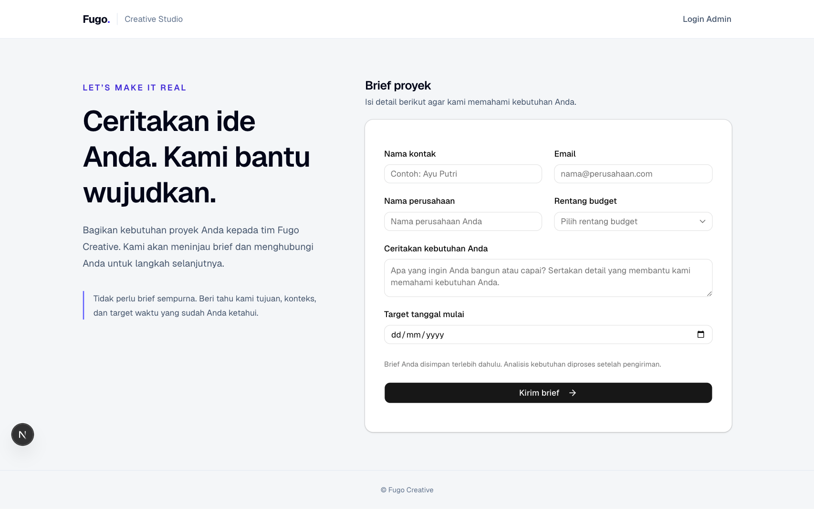
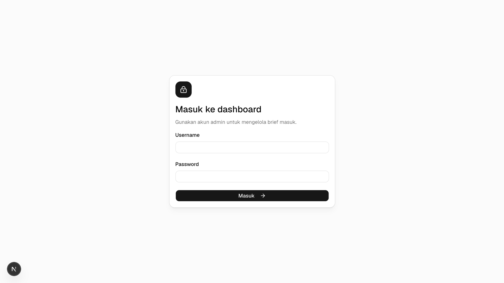
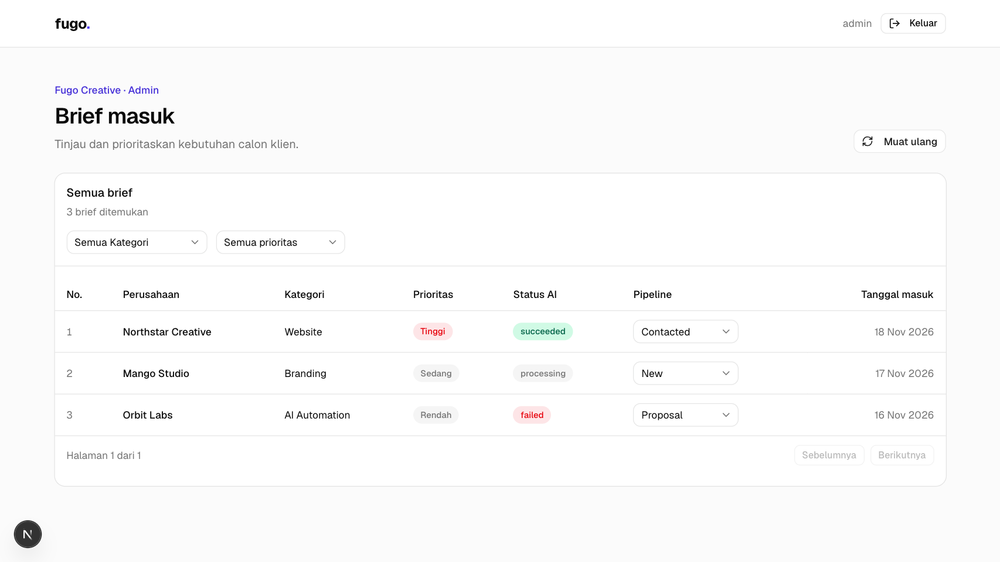
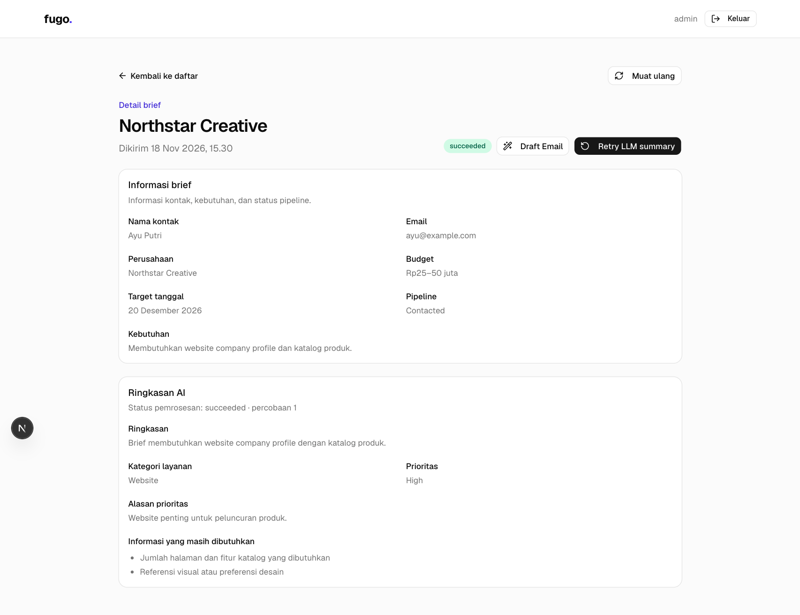
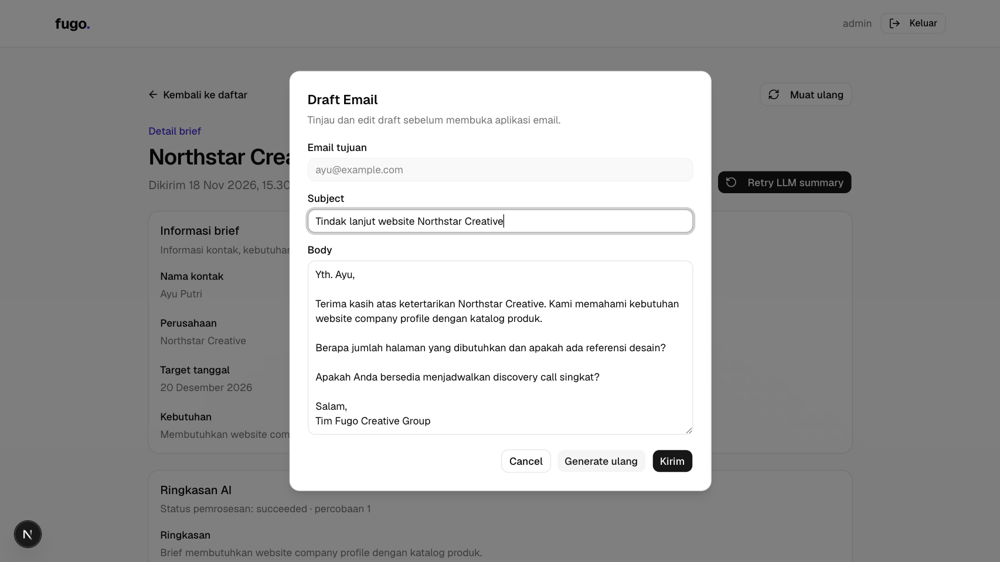

# Fugo Creative — Brief Intake & Triage

Aplikasi internal untuk menerima brief calon klien, memprosesnya secara asinkron dengan LLM, dan membantu tim sales menentukan prioritas serta mengelola pipeline.

> Project ini dibuat untuk menyelesaikan technical test Fugo Creative Group.

## Demo

- **Aplikasi:** <https://fugocreative.dapino.my.id>
- **Video walkthrough:** dikirim melalui email kepada Fugo Creative Group.
- **Akun admin reviewer:** dikirim melalui email;

## Stack

- **Backend:** Go 1.27+, Chi v5, `pgx/v5`, Goose, JWT.
- **Frontend:** Next.js App Router, TypeScript, NextAuth, Tailwind CSS.
- **Database:** PostgreSQL 18+.
- **LLM:** API kompatibel OpenAI, dikonfigurasi melalui environment. Docker Compose memakai default OpenRouter dan model `openrouter/free`;
- **Deploy:** container Docker di VPS.

## Menjalankan lokal

### Docker Compose

Butuh Docker Compose dan API key LLM yang valid.

```sh
cp .env.example .env
```

Isi `ADMIN_USERNAME`, `ADMIN_PASSWORD`, `JWT_SECRET`, `LLM_PROVIDER`, `LLM_MODEL`, `LLM_API_KEY`, `LLM_ENDPOINT`, `CORS_ALLOWED_ORIGIN`, `NEXTAUTH_SECRET`, dan `NEXTAUTH_URL`. Gunakan secret kuat dan origin frontend lokal, misalnya `http://localhost:3000`. Lalu jalankan:

```sh
docker compose up -d --build
```

Frontend tersedia di `http://localhost:3000`; backend di `http://localhost:8080`. Migrasi dijalankan otomatis saat backend mulai.

### Manual

Butuh Go 1.27+, Bun, dan PostgreSQL 18+ yang dapat diakses. Atur `DATABASE_URL` serta environment backend seperti di bawah.

```sh
cd backend
cp .env.example .env
go run ./cmd/server
```

Jika PostgreSQL lokal belum tersedia, jalankan service database Compose dari root repository:

```sh
docker compose up -d db
```

Sesuaikan `DATABASE_URL` di `backend/.env` dengan user, password, dan database yang dipakai Compose. Backend menerapkan migrasi Goose otomatis saat startup.

Di terminal lain, konfigurasi frontend dan jalankan:

```sh
cd frontend
cp .env.example .env.local
bun install
bun run dev
```

Frontend menggunakan `BACKEND_API_URL=http://localhost:8080/api` secara default. Siapkan kredensial admin yang sama dengan konfigurasi backend untuk login lokal.

### Environment variables

| Variabel                                                   | Digunakan oleh | Keterangan                                                                                                                 |
| ---------------------------------------------------------- | -------------- | -------------------------------------------------------------------------------------------------------------------------- |
| `POSTGRES_USER`, `POSTGRES_PASSWORD`, `POSTGRES_DB`        | Compose        | Kredensial dan nama database; default Compose tersedia untuk development lokal.                                            |
| `DATABASE_URL`                                             | Backend        | URL PostgreSQL lengkap dengan kredensial dan nama database.                                                                |
| `ADMIN_USERNAME`, `ADMIN_PASSWORD`                         | Backend        | Satu akun admin; password wajib unik dan kuat.                                                                             |
| `JWT_SECRET`                                               | Backend        | Secret penandatangan JWT, minimal 32 byte.                                                                                 |
| `JWT_TTL`                                                  | Backend        | Masa berlaku JWT, contoh `1h` atau `1d`; default `1h`.                                                                     |
| `SERVER_ADDR`                                              | Backend        | Alamat listen, default `:8080`.                                                                                            |
| `CORS_ALLOWED_ORIGIN`                                      | Backend        | Satu origin frontend, tanpa path; wajib diisi.                                                                             |
| `LLM_PROVIDER`, `LLM_MODEL`, `LLM_API_KEY`, `LLM_ENDPOINT` | Backend        | Konfigurasi provider kompatibel OpenAI. Isi semuanya atau kosongkan semuanya; kosong berarti pemrosesan AI tidak tersedia. |
| `LLM_TIMEOUT`                                              | Backend        | Timeout panggilan LLM, default `30s`.                                                                                      |
| `BACKEND_API_URL`                                          | Frontend       | URL API backend; hanya dibaca server Next.js. Default `http://localhost:8080/api`.                                         |
| `NEXTAUTH_SECRET`                                          | Frontend       | Secret enkripsi session NextAuth; buat nilai acak terpisah per environment.                                                |
| `NEXTAUTH_URL`                                             | Frontend       | Origin frontend, misalnya `http://localhost:3000`.                                                                         |

File contoh tersedia di root (`.env.example` untuk Compose), `backend/.env.example`, dan `frontend/.env.example`.

## Struktur repository

```text
.
├── backend/
│   ├── cmd/server/          # Entry point HTTP server
│   ├── internal/
│   │   ├── config/          # Konfigurasi environment dan logging
│   │   ├── database/        # Koneksi PostgreSQL dan runner migrasi
│   │   ├── handler/         # HTTP handlers
│   │   ├── middleware/      # Middleware HTTP
│   │   ├── model/           # Model dan payload API
│   │   ├── repository/      # Query database
│   │   ├── service/         # Aturan bisnis dan integrasi LLM
│   │   └── worker/          # Background AI jobs
│   ├── migrations/          # Migrasi SQL Goose
│   └── pkg/                 # Helpers dan library internal
├── frontend/
│   └── src/
│       ├── app/             # Halaman dan route handlers Next.js
│       ├── components/      # Komponen UI
│       ├── lib/             # Auth dan helper server API
│       └── types/           # Deklarasi TypeScript
└── docker-compose.yaml
```

## Arsitektur dan alur data

- `frontend/`: formulir publik, login, dashboard, dan detail brief. Request browser melewati route handler Next.js; token backend disimpan di cookie JWT terenkripsi NextAuth dan tidak dikirim ke browser session.
- `backend/internal/handler`: HTTP endpoint; `service`: aturan bisnis dan integrasi LLM; `repository`: akses SQL; `worker`: pemrosesan job AI di goroutine.
- Saat brief dikirim, backend menyimpan brief dan job awal dalam satu transaksi. Worker mengambil job secara atomik dengan row locking, memproses paling banyak dua job bersamaan, lalu menyimpan hasil atau status gagal.
- Endpoint admin menggunakan JWT. Dashboard menyediakan filter prioritas/kategori, detail brief, proses ulang AI, perubahan pipeline (`New` → `Contacted` → `Proposal` → `Won`/`Lost`), dan pembuatan draft email.
- Respons LLM dalam JSON terstruktur dan divalidasi (field wajib, tipe, enum, serta properti tambahan ditolak) sebelum disimpan. Key LLM hanya berada di backend.

## Skema database

| Tabel     | Data utama                                                                                                                                                       | Constraint dan index penting                                                                                                                                     |
| --------- | ---------------------------------------------------------------------------------------------------------------------------------------------------------------- | ---------------------------------------------------------------------------------------------------------------------------------------------------------------- |
| `briefs`  | UUIDv7, kontak, email, perusahaan, kebutuhan, rentang budget, tanggal target, status AI, hasil AI dan draft email `jsonb`, error AI, status pipeline, timestamp. | Field wajib tidak kosong; tanggal target tidak lampau; status dibatasi enum; hasil AI wajib ada jika status `succeeded`. Index `created_at DESC`.                |
| `ai_jobs` | UUIDv7, relasi brief, status job, nomor percobaan, error, dan timestamp lifecycle.                                                                               | Foreign key ke `briefs` dengan `ON DELETE CASCADE`; attempt positif; status enum. Index antrean parsial dan unique index parsial untuk satu job aktif per brief. |

Migrasi Goose berada di `backend/migrations/` dan diterapkan otomatis saat server mulai. UUIDv7 memerlukan PostgreSQL 18.

## Keputusan teknis dan trade-off

- **Monolith sederhana:** satu backend Go dan satu frontend Next.js, tanpa layanan queue eksternal; persistent job disimpan di PostgreSQL.
- **Worker goroutine + polling:** mengurangi ketergantungan operasional dan menjaga submit tetap cepat. Kapasitas worker per proses dibatasi dua; penskalaan lebih lanjut memerlukan pengukuran dan strategi worker lintas instance.
- **Satu akun admin dari environment:** sesuai ruang lingkup MVP; tidak ada manajemen user/role atau reset password.
- **NextAuth sebagai proxy session:** token API tidak terekspos ke browser, tetapi proteksi tetap bergantung pada secret session dan konfigurasi deployment yang benar.
- **Provider kompatibel OpenAI:** memudahkan penggantian vendor tanpa mengubah alur aplikasi; ketersediaan, format kompatibilitas, biaya, dan kualitas output mengikuti provider/model yang dikonfigurasi.
- **Tidak ada pengiriman email otomatis:** draft email hanya dibuat untuk ditinjau admin. Docker Compose ditujukan untuk development/single-host; deployment publik tetap perlu secret kuat dan konfigurasi produksi yang sesuai.

## AI usage log

AI coding assistant yang digunakan: **OpenAI Codex melalui OMP (Oh-My-PI)**. Dipakai untuk implementasi, debugging backend/frontend, konfigurasi, migrasi, serta dokumentasi dari awal hingga akhir. Output AI diperiksa terhadap kebutuhan dan kode; dua contoh koreksi:

1. **Manajemen session frontend:** rancangan awal membuat mekanisme session sendiri. Saya mengarahkannya untuk memakai NextAuth agar autentikasi, lifecycle session, dan proteksi route mengikuti solusi yang sudah teruji, sekaligus menghindari implementasi session dan penanganan token custom. Token backend tetap disimpan dalam cookie JWT terenkripsi NextAuth.
2. **Request LLM backend:** rancangan awal memakai `net/http` dari Go standard library untuk memanggil LLM API. Saya mengarahkannya untuk memakai `langchaingo/llms`, agar integrasi model OpenAI-compatible, konfigurasi provider/model, serta structured output berbasis JSON Schema memakai API library yang sama dan tidak perlu merawat implementasi request/format output sendiri. Hasil tetap divalidasi di kode sebelum disimpan.

## API

Kontrak endpoint dan contoh payload ada di [`SPEC.md`](SPEC.md). API utama:

- `POST /api/public/briefs`
- `POST /api/auth/login`, `GET /api/auth/me`
- `GET /api/admin/briefs`, `GET /api/admin/briefs/{id}`
- `POST /api/admin/briefs/{id}/reprocess`
- `PATCH /api/admin/briefs/{id}/pipeline`
- `POST /api/admin/briefs/{id}/email-draft`

Dokumentasi Postman: <https://documenter.getpostman.com/view/45407252/2sBYHbrwK5>

## Screenshot

| Halaman            | Screenshot                                                |
| ------------------ | --------------------------------------------------------- |
| Form brief publik  |    |
| Login admin        |                |
| Dashboard admin    |        |
| Detail brief       |              |
| Dialog draft email |  |

## Author

Davi Nomoeh Dani · <dapino.dev@gmil.com> · +6282325441718
